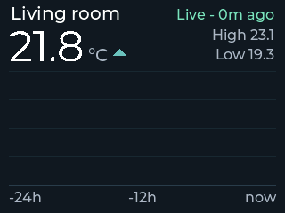
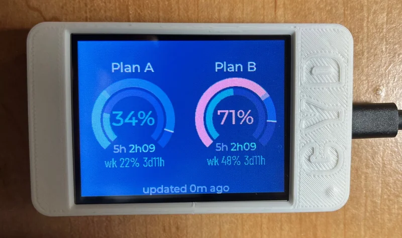
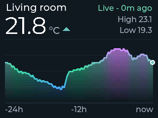
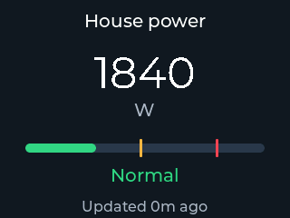
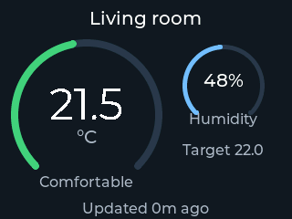
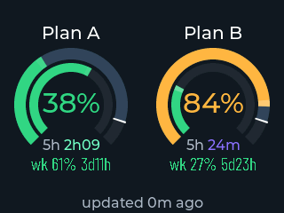
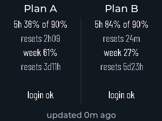
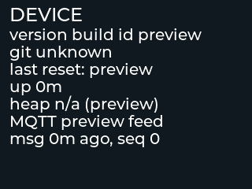

# cyd-dash

A friendly dashboard for the ESP32-2432S028 "Cheap Yellow Display" (CYD), built with ESPHome
and LVGL. It shows values from your MQTT broker on clear, colourful pages, and it is easy to
set up and to extend with pages of your own.

<p align="center">
  
  &nbsp;
  
</p>

On the left, the history page as the desktop preview draws it. On the right, a CYD on a desk.

## The pages

Pick any of these, in any order. Each one reads its values from topics you choose.

| Page | What it shows | Inputs |
|---|---|---|
|  | **History**: one reading over time as a smooth graph, with the newest value, a trend arrow and optional warn and alert levels. | [history](docs/pages.md#history) · [guide](docs/history.md) |
|  | **Big number**: one reading in large digits, with a level bar and optional warn and alert levels. | [stat](docs/pages.md#big-number) |
|  | **Thermostat**: room temperature on a comfort arc, with humidity and a target if you have them. | [thermostat](docs/pages.md#thermostat) |
|  | **Usage**: one or two gauges for a five-hour and a weekly allowance, with reset countdowns. | [usage](docs/pages.md#usage) · [guide](docs/usage.md) |
|  | **Usage detail**: the usage page's numbers in plain words. It needs the usage page too. | [detail](docs/pages.md#usage-detail) |
|  | **Hello World**: a greeting, the time and a small moving dot. A starting point for your own page. | [no inputs](docs/pages.md#hello-world) |
|  | **Device**: the CYD itself: version, uptime, memory, network and broker. | [no inputs](docs/pages.md#device) |

## Quick start

### Quick start for humans

Have a coding agent (Claude Code, Codex, or similar)? Plug your CYD in by USB, then paste
this to your agent. It asks you for what it needs, sets everything up and shows you the
Hello World page, first on your computer and then on your CYD.

```text
I'd like to try cyd-dash on my CYD (an ESP32-2432S028 touch screen). Please:

1. Clone https://github.com/flavio-fernandes/cyd-dash and read its AGENTS.md
   first. Follow the repo's docs and skills rather than guessing.
2. Before installing or flashing anything, ask me, in one short list, for what you
   need: my operating system, the CYD's USB serial port (or tell me how to find it),
   my Wi-Fi network name, my time zone, and whether I have an MQTT broker. If I have
   no broker, use a placeholder: the Hello World page does not need one. Don't ask
   for my Wi-Fi password in the chat: leave it empty in the settings file, tell me
   which line to fill in, and wait until I say it's done.
3. Follow docs/install.md, starting with "Try Hello World first (no broker
   needed)". Install missing packages in a virtual environment or container.
4. Show me the Hello World page in the desktop preview first: open the preview
   window, or save a screenshot and show it to me.
5. Build the firmware with the Hello World and device pages, flash it to my CYD
   over USB, and check its boot log to confirm it is running.
6. Finish with a few lines: what I'm looking at, how to use the touch bar, and
   how I can ask you to make a page of my own and share it as a pull request.
```

When it's done, try: *"Add a page that shows the outside temperature from my MQTT broker."*
[Add a page](docs/add-a-page.md) is the guide your agent will follow.

### Step by step

1. **Get a CYD.** Look for "ESP32-2432S028": a 2.8" 320x240 ILI9341 screen with XPT2046 touch.
   You also need a USB data cable, and an MQTT broker on your network for your own values
   ([Hello World](docs/install.md#try-hello-world-first-no-broker-needed) needs none).
2. **Install ESPHome** (2026.9 or newer) in a virtual environment (on Ubuntu, run
   `sudo apt install python3-venv` first):
   ```bash
   python3 -m venv .venv
   . .venv/bin/activate
   pip install esphome paho-mqtt pyyaml
   ```
   Activate `.venv` again in each new terminal.
   Docker works too: see [Install and flash](docs/install.md#esphome-with-docker).
3. **Get this repository.**
   ```bash
   git clone https://github.com/flavio-fernandes/cyd-dash cyd-dash
   cd cyd-dash
   ```
4. **Copy the three example files** and fill in your Wi-Fi, broker and an OTA password. Git
   ignores the copies, so your values stay on your computer.
   ```bash
   cp firmware/site.example.yaml firmware/site.yaml
   cp firmware/secrets.example.yaml firmware/secrets.yaml
   cat firmware/bindings.example.yaml firmware/bindings.thermostat.example.yaml firmware/bindings.history.example.yaml > firmware/bindings.yaml
   ```
5. **Pick your pages** in `firmware/site.yaml`:
   ```yaml
   cyd:
     pages: [history, thermostat, hello, device]
     rotation_interval: 20
   ```
6. **Build and flash.** Plug the CYD in by USB and give its serial port
   ([finding the port](docs/install.md#the-first-flash-over-usb)). Later updates can go over
   Wi-Fi: give its network address instead, for example `cyd-dash.local`.
   ```bash
   python3 tools/cyd_build.py run --device /dev/ttyUSB0
   ```
7. **Send it some sample values**, and watch the pages fill in:
   ```bash
   python3 tools/publish_example.py --broker mqtt.example.com --interval 5
   ```

The build prints a short plan first: your pages and where each value comes from. If something
is missing it tells you what to add. [Configure](docs/configure.md) explains every key.

### Try it without a CYD

The same firmware runs in a window on your computer, and can save true-colour screenshots.
With the quick start's pages, this shows the history page with two hours of sample readings:

```bash
python3 tools/cyd_preview.py run --page history --feed tools/examples/history-fresh.json
```

`tools/examples/` has a feed for every page, such as `thermostat-comfortable.json`,
`hello.json` and `usage.json`. A page whose feed you did not send shows "Waiting". See
[the desktop preview](docs/preview.md).

## Learn more

- [Install and flash](docs/install.md): ESPHome, the first USB flash, updates over Wi-Fi, logs.
- [Using your CYD](docs/using-your-cyd.md): the nav bar, the screensaver, touch calibration.
- [Configure](docs/configure.md): `site.yaml` and `bindings.yaml`, with examples.
- [Add a page](docs/add-a-page.md): from a copy of the template to a page in your build.
- [MQTT reference](docs/mqtt.md): the status topic and every command.
- [Contributing](CONTRIBUTING.md): how to propose a page or a fix.
- [All docs](docs/README.md)

## Credits

With thanks to the projects that inspired this one:

- [ClaudeGauge](https://www.hackster.io/dorofino/claudegauge-real-time-ai-usage-monitor-on-esp32-s3-with-a-a82d4b) by dorofino
- [Gauge chart for analog value representation](https://www.hackster.io/los_electrofaster/gauge-chart-for-analog-value-representation-8f8037) by los_electrofaster
- [Claude usage checker](https://www.hackster.io/atnovix/claude-usage-checker-35ff24) by atnovix

Built on [ESPHome](https://esphome.io) and [LVGL](https://lvgl.io).

## License

MIT: see [LICENSE](LICENSE).
