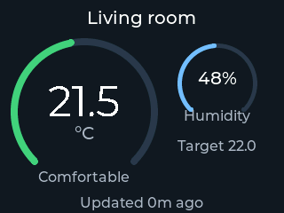
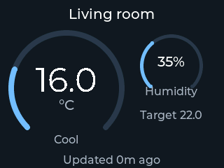
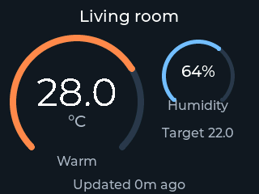
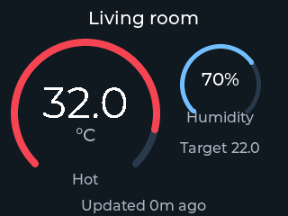
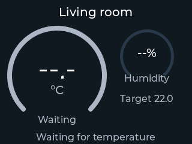
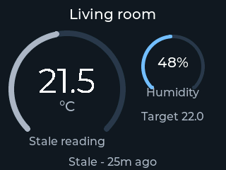
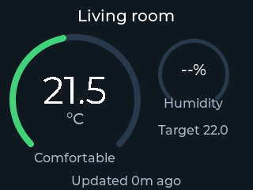
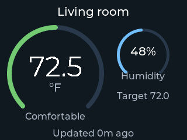
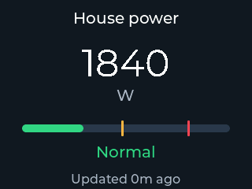
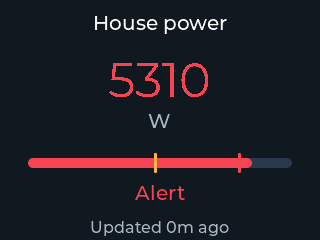

# Add a page

Start with Hello World: a greeting, a clock and an eight-pixel moving dot.
Then add a room-climate face with typed MQTT inputs. Both use the same page API.




## 1. Copy the template

From the repository root, with Python, ESPHome and SDL2 installed as described in
[the preview guide](preview.md), copy the three files:

```bash
mkdir -p firmware/pages/mypage
cp -r firmware/pages/_template/. firmware/pages/mypage/
```

In your copied `manifest.yaml`, `page.yaml` and `example.h`, replace every occurrence
of `example` with `mypage`. Rename `example.h` to `mypage.h` as well. Header filenames
must be unique across pages. There is no extra registration file to edit.

Keep the included `hello` folder unchanged: it is the finished example to compare
with. The sections below show that example's names. For your copy, use `mypage`
instead of `hello` in the manifest, widget IDs, namespace, header filename, site
selection and preview commands. Keep `tools/examples/hello.json` as the example
feed; it contains no page-specific inputs. Folders beginning with `_` are not
selectable pages.

## 2. Describe the page

The resulting `firmware/pages/hello/manifest.yaml` declares:

```yaml
name: hello
title: Hello World
description: A greeting, the local time and a small stepped dot.
rotate: true
slots: {}
headers: [hello.h]
hooks:
  build: cyd_hello::build
  render: cyd_hello::render
  tick10: cyd_hello::tick10
```

The folder and `name` must match. `headers` lists every header ESPHome must copy
into the build, in dependency order. `requires: [other_page]` declares a page
input dependency; do not rely on page order for font initialization.

Put quotes around a `doc` that contains a comma or a colon:
`doc: 'Digits after the point, 0 to 3.'`. Inside `{...}`, YAML reads an unquoted
comma as the start of another key, and the build reports an unknown key.

`page.yaml` is an ESPHome package. It declares `hello_page`, a 320×240
`hello_root`, and hidden font holders at 16, 20 and 32 px. Keep their order: the
header reads the first three children to obtain those fonts. A C++-created arc
also needs a hidden YAML arc so ESPHome enables that LVGL feature.

A font of your own, such as a 48 px digits-only hero, goes in `page.yaml` as an
ESPHome `font:` block, and a hidden holder label uses it. The manifest accepts only
the keys shown above. `firmware/pages/thermostat/page.yaml` shows both.

## 3. Draw once, update only what changed

Read `firmware/pages/hello/hello.h` alongside this section:

- `build(lv_obj_t *root)` creates the greeting, clock and dot once. Clear
  `LV_OBJ_FLAG_SCROLLABLE` on your root and any containers you create.
- `render(const cyd_page::Ctx &ctx)` receives wall-clock epoch seconds (`-1`
  until set), visibility and broker connection state. It is called for changed
  inputs, page entry and once per second while shown. Skip visual work when
  `ctx.visible` is false. Cache displayed text and styles before calling setters.
- `tick10(bool visible)` runs from the shared 100 ms clock. Return immediately
  when hidden. Hello moves only the 8×8 dot; do not add another interval or a
  free-running LVGL animation.

The clock uses local time and displays “Waiting for time” until it is known.
Font sizes are 48 px for a digits-only hero number, 32 px for a main value,
20 px for secondary information, and at least 16 px for close-range detail. Leave a three-pixel safe margin for drift.
Text should reach 4.5:1 contrast against the `0x101820` background. A colour
change should also have a text or shape cue. [Keep it smooth and readable](ui-guidelines.md)
has the measured numbers behind these rules, and shows how to measure your page.

## 4. Select and preview your page

Create a local preview site and an empty binding file. The clock needs a timezone;
`topic_prefix` names status messages even though this preview uses no broker:

```yaml
# mypage-site.yaml
substitutions:
  timezone: Etc/UTC
  topic_prefix: cyd/dash
cyd:
  pages: [mypage]
```

```yaml
# mypage-bindings.yaml
{}
```

Run these commands for the copy you made in step 1:

```bash
python3 tools/cyd_build.py prepare --site mypage-site.yaml --bindings mypage-bindings.yaml
python3 tools/cyd_preview.py shot --site mypage-site.yaml --bindings mypage-bindings.yaml --page mypage --feed tools/examples/hello.json --out mypage.png
python3 tools/cyd_preview.py shot --site mypage-site.yaml --bindings mypage-bindings.yaml --page mypage --frames 12 --out mypage-motion.png
```

No bindings or broker are needed. Check the greeting, a ticking clock and the
moving dot. Navigation arrows are hidden for a one-page build. Keep preview-only
site files separate from your device's `firmware/site.yaml`.

## 5. Add inputs: the thermostat

The complete second example is in `firmware/pages/thermostat/`. Its manifest
requires a numeric `temperature`, while `humidity`, `setpoint` and `updated_at`
are optional. `label` defaults to “Living room”; `unit` defaults to `°C`.
The generated [input reference](pages.md) lists all slots and defaults.

Required means a binding is needed before compilation, not that a publisher is
already online. Missing, null, invalid or out-of-range readings show waiting,
not zero. Optional humidity disappears into an unknown `--%` gauge when absent;
an absent setpoint leaves its line empty. The temperature's own arrival age
makes it stale after 20 minutes. An optional measurement timestamp can make it
older but cannot make an old arrival fresh. Other topics cannot refresh it.

Start with `firmware/bindings.thermostat.example.yaml`:

```yaml
thermostat:
  temperature: {topic: home/livingroom/climate, json: temperature}
  humidity: {topic: home/livingroom/climate, json: humidity}
  label: {value: Living room}
  unit: {value: '°C'}
  setpoint: {value: 22}
  updated_at: {topic: home/livingroom/climate, json: updated_at}
```

For a raw numeric topic use `{topic: home/livingroom/temperature}` without `json`.
JSON paths support dots and array indexes. An optional slot with no default is
invalid when unbound; call `cyd_slots::valid(CYD_SLOT_thermostat_humidity)` before
using it, or check `std::isfinite(cyd_slots::number(...))`. Text, booleans and epoch
slots have `text`, `flag` and `epoch` accessors. Slot IDs are generated constants.

A default is used only when the bindings leave the slot out. A text slot bound to a
topic stays empty until its first message, so give it a fallback in your header,
as `thermostat.h` does for `unit`.

The thermostat uses a digits-only 48 px measured value, a 270° comfort arc, an optional
humidity gauge and a trend arrow comparing successive visible fresh readings.
The number changes immediately; the arc eases toward a changed value in bounded
100 ms steps, then stops. It does not continuously breathe. The comfort colours
interpolate blue → green → amber → red; the band name also carries meaning.
Illustrative bands are cool below 19°C, comfortable through 24°C, warm through
28°C and hot above. These are presentation choices, not health recommendations.

Choose `°F` to show Fahrenheit and publish both temperature and setpoint in
Fahrenheit. The display does not convert incoming measurements; it converts
internally only to choose the same comfort band. Other unit strings show a
“Choose °C or °F” warning. This page is read-only: a target is informational and
never sends a heating command.

Copy `mypage-site.yaml` to `thermostat-site.yaml` and change its page list to
`pages: [thermostat]`, keeping the timezone and topic prefix. Then:

```bash
python3 tools/cyd_preview.py shot --site thermostat-site.yaml --bindings firmware/bindings.thermostat.example.yaml --page thermostat --feed tools/examples/thermostat-comfortable.json --out thermostat.png
```

Repeat with the `thermostat-cool`, `thermostat-warm`, `thermostat-hot`,
`thermostat-waiting`, `thermostat-stale` and `thermostat-no-humidity` feeds.
For `thermostat-fahrenheit`, first copy the bindings and change `unit` to `°F`
and `setpoint` to a Fahrenheit value.









A third example, `firmware/pages/stat/`, shows one big number, such as the power
a home uses, turning amber above `warn` and red above `alert`. The word under the bar
(Normal, High, Alert) carries the level too:




## 6. Compile, flash, and check status

Set up `firmware/site.yaml` and secrets using the project's device setup guide.
In its `cyd.pages` list select `[hello]`, `[thermostat]`, or several pages. Copy
and adapt the needed bindings into `firmware/bindings.yaml`.

```bash
python3 tools/cyd_build.py compile
python3 tools/cyd_build.py run
```

`run` prepares, compiles and asks ESPHome to upload. Select your connected device
in ESPHome; do not flash a board you have not identified. After boot, use your
configured topic prefix to inspect status:

```bash
python3 tools/cyd_mqtt.py --broker BROKER --prefix cyd/dash cmd 'page thermostat'
python3 tools/cyd_mqtt.py --broker BROKER --prefix cyd/dash status --expect page=thermostat --wait 10
```

The `pages` array confirms which pages are included. The thermostat also adds
`thermostat.state` (`waiting`, `fresh`, `stale` or `invalid unit`) after rendering.
Status may be retained: it is not proof that a new command ran. Check a new boot
log and the physical display as well. Never put credentials into screenshots.

## 7. Regenerate the reference and propose your change

```bash
python3 tools/cyd_build.py docs
python3 -m unittest discover -s tests -v
```

The tests compare `docs/pages.md` with every public manifest; they fail when the
reference is stale. Include generated docs with any slot change.

A few more things the tests and reviewers look for:

- **Status fields.** If your page has a `status` hook, describe its fields in the
  page table of [the MQTT reference](mqtt.md#fields). The tests check that every
  field the firmware publishes is described there.
- **Sample values.** `tools/publish_example.py` sends generic numbers (around 38)
  for a page it does not know, which rarely suit a new page. Add a
  `<name>_sample(name, step, now)` function like `thermostat_sample`, call it from
  `sample()`, and add a test next to the thermostat's in `tests/test_publish_example.py`.
- **Small images.** Preview screenshots are saved uncompressed, about 230 KB. With
  Pillow, `Image.open('mypage.png').convert('RGB').save('docs/images/mypage.png', optimize=True)`
  brings a page to about 6 KB.

Before opening a pull request, compile your page alone and in different page
orders, capture waiting/fresh/stale and missing-optional-input screenshots, and
check clipping at drift offsets. Keep PNG or WebP images under about 100 KB.
Explain bindings and limits, include the test output, and say which device checks
you actually ran. Exclude local sites, secrets, generated build files and firmware
images. Open the pull request from your fork for review.
