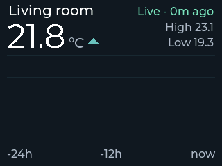
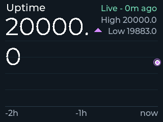
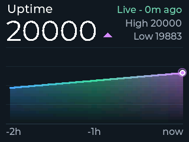
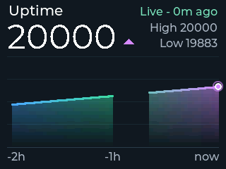
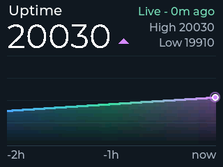

# A history of your readings



A day of readings at a glance: the latest value up top, and a graph that fills
most of the screen. When the page comes on screen, the graph draws itself in
from the left, and then the newest reading gently pulses. (The picture uses
`window: 86400` and `period: 600`, see [Start with a full graph](#start-with-a-full-graph).
A still version is [images/history.png](images/history.png).)

Bind a temperature topic and select `history` in your site's page list:

```yaml
history:
  value: {topic: home/livingroom/climate, json: temperature}
  label: {value: Living room}
  unit: {value: '°C'}
  warn: {value: 25}
  alert: {value: 28}
  seed: {topic: home/livingroom/history}
  window: {value: 7200}
  period: {value: 60}
```

For a raw numeric payload, omit `json`. The [input reference](pages.md) lists
all inputs; `firmware/bindings.history.example.yaml` is a ready-to-copy version
for a raw temperature topic. The page never publishes a control command.

## Time, not message count

The default view spans two hours in one-minute buckets. The last received value
in each bucket wins; a burst cannot squeeze the time axis. Empty buckets are
not invented. The line breaks at gaps longer than twice the usual spacing of
occupied buckets near each segment, with a minimum limit of two periods. The
usual spacing is the lower median of up to five neighboring time steps. A feed
that changes from one reading a minute to one every five minutes can therefore
draw both parts, while a longer interruption still leaves a gap. More readings
help establish the cadence at the newest edge. Collection
continues while another page is visible. Incoming slots are sampled by the
shared 100 ms clock, so multiple arrivals in one clock step coalesce to the last.
A repeated equal reading still renews freshness and populates its new bucket.
Time comes from an extended monotonic clock; setting wall time does not move
live history. History lives in RAM, not flash, and resets at reboot.

`window` is clamped to 60–86400 seconds. `period` is at least one second and is
raised to `ceil(window / 240)` when necessary. Changing either effective setting
clears history. The fixed buffer holds 241 timestamp/value entries (3856 bytes
on the supported targets), with no heap allocation for the buffer. Slot strings,
widgets and temporary parsing need additional memory.

## Start with a full graph

Publish a retained JSON array to the seed topic:

```json
[20.1, 20.3, 20.5, 20.4, 20.8, 21.0]
```

Values are oldest first, one per effective period, ending at arrival time.
For a day of history, set `window: {value: 86400}` and
`period: {value: 600}`, then send up to 145 readings.

Alternatively send `[[epoch, value], ...]`. Epochs must be whole Unix seconds,
nondecreasing and not in the future. Pair seeds wait for a valid wall clock;
their age is preserved, so old retained readings do not become fresh on reboot.
A numbers-only seed cannot convey age and is fresh on arrival.

Seeds accept at most 241 finite values within +/-1000000. Mixed arrays, nulls,
strings, malformed JSON and nonfinite numbers reject the whole seed without
changing existing history. Out-of-window points are discarded. Only the first
valid seed is applied per boot; subsequent live arrivals extend it. A pending
live reading is applied after the seed. Keep a seed payload reasonably short;
it also occupies the text slot's dynamic string storage.

## Reading the face

The header is one band. The title and a status line (`Live - 0m ago`) share the
top line. Below them sits the latest reading in 48 px digits with its unit right
after it, then a small triangle: ▲ rising, ▼ falling, a short bar when steady.
High and Low for the visible window sit on the right. Readings with a magnitude
of 1000 or more use whole numbers in both the large reading and High/Low; smaller
readings keep one decimal place. The large reading stays on one line and truncates
when it cannot fit, rather than wrapping onto the graph. The thermostat's
digits-only font recipe drives the number; other labels are 20 px and 16 px.

The graph uses the rest of the screen. Its line is smoothed and never overshoots
its samples. The line and the top of the area take their colour from the value:
the lowest reading in view is blue, the middle is green, the highest is violet,
so an ordinary day already shows a gentle range of colours. At the `warn`
threshold the colour turns amber and the status says `Warm`; at `alert` it turns
red and the status says `Alert`. The area below the line is one smooth vertical
gradient that fades into the background.

The time labels are friendly: `-2h`, `-1h`, `now` for the default window, or
`-30m`, `-6h`, `-24h` for other windows.

The triangle compares the last two occupied buckets. One sample has a dot but no
triangle or invented area. Optional `min`
and `max` fix either or both scale edges; an invalid range falls back to automatic
scaling. Automatic scale adds headroom and rounds to 1/2/5 steps. Values outside
a fixed scale are clipped to its edge without changing the hero reading.

After three periods (at least three minutes) without a reading, the line turns grey
and the status says how old the last reading is. Eventually the whole window expires into a
waiting face. No input shows a friendly placeholder rather than a zero.

## Motion

The page moves only while it is on screen, and every step comes from the
firmware's one 100 ms clock (`tick10`), so it never runs faster than 10 frames a
second:

- **Sweep-in:** when the page arrives (or its first reading does), the line and
  its fill draw from left to right in about a second, in 10 steps. Each step
  redraws only the newly revealed strip.
- **Pulse:** a ring grows out of the newest reading's dot and fades, every
  1.5 seconds. Only the ring's 30×30 px square is redrawn.
- **Slide:** when a new time bucket starts, the graph eases one bucket to the
  left over 4 frames. This is the one step that redraws the whole graph.
- **New reading:** the big number steps to the new value over a few frames, and
  a new trend triangle fades in.
- **Stale:** the motion stops and the line turns grey.
- **Waiting:** a soft dotted line with a blue glint drifting along it, so the
  page never looks like an empty box.

The status JSON shows what the page is doing: `history.motion` is `sweep`,
`pulse`, `slide`, `waiting` or `still`, and `history.motion_frames` counts the
animated frames. The core fields `busy`, `refr_ms` and `inv_px` show how much
drawing it costs on your device.

## Try it with sample data

```bash
python3 tools/publish_example.py --broker YOUR_BROKER --interval 5
```

With the history page bound, the first round publishes a seed (the last two
hours, one reading a minute), and every round after it publishes a living-room
temperature that changes slowly. Point your bindings at test topics first.

## Preview and checks

Select `history` in a preview site as described in [the preview guide](preview.md):

```bash
python3 tools/cyd_preview.py shot --site history-site.yaml --bindings firmware/bindings.history.example.yaml --page history --feed tools/examples/history-fresh.json --out history.png
python3 -m unittest discover -s tests -v
```

Try the `history-alert`, `history-waiting`, `history-stale` and `history-single`
feeds too. The C++ model tests compile the actual firmware header with address
and undefined-behavior sanitizers; they require a C++17 compiler. Preview refresh
measurements describe desktop rendering, not display-bus performance or device
free heap. Measure those on the device before drawing conclusions about load.

For sparse readings with large values, use `firmware/bindings.history-slow.example.yaml`
with `tools/examples/history-slow.json`. It seeds timestamped readings three minutes
apart and delivers a live numeric string. `history-slow-gap.json` leaves a longer
outage in the middle. `history-slow-stale.json` shows older readings, and
`history-large-negative.json` checks a large negative value in the header.
`history-seed-transition.json` shows a dense seed followed by slower live readings.
These are synthetic examples, separate from your live topics.

| Before: sparse readings and a wrapped number | Slow readings after the fix | A longer outage stays empty |
| --- | --- | --- |
|  |  |  |

A dense seed followed by slower readings:


