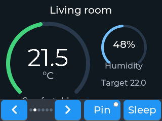
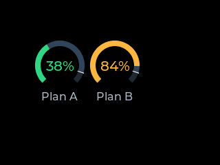
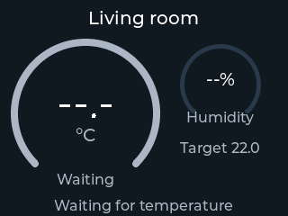
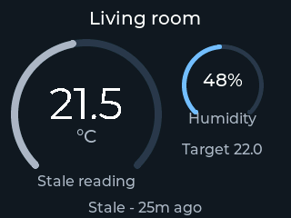
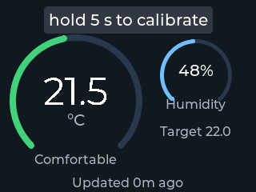
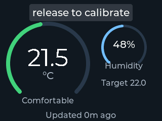
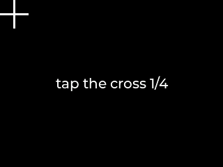

# Using your CYD

Everything here works with a fingertip. Every button also has an MQTT command, listed in the
[MQTT reference](mqtt.md#commands).

## The nav bar

**Tap the screen once** and the nav bar appears at the bottom. That first tap only shows the
bar, so a stray touch never changes anything. While the bar is showing, tap a button:

| button | what it does |
|---|---|
| **‹** and **›** | the previous or next page. They also pin that page (see Pin). |
| the dots | where you are: one dot per page, the bright one is on screen |
| **Pin** | switches between pinned and rotating. The small dot in its corner is white when the page is pinned, dark when the pages rotate. |
| **Sleep** | turns the screen off |

One tap is one tap: if the touch panel flickers during a press, the CYD still counts a single
tap, and a button acts once per tap (a second tap on a button within 0.4 s is ignored). The
buttons work once the bar has been showing for 0.3 s. To check, see `touch` in the
[status](mqtt.md#fields).

The bar hides again 6 seconds after your last tap. With only one page in your build, the
arrows and dots are hidden.

### Rotating and pinned

- **Rotating** (Auto mode, the dot in Pin is dark): the CYD moves to the next page every
  `rotation_interval` seconds (20 by default, see [Configure](configure.md#siteyaml)).
- **Pinned** (the dot is white): the page stays. Tapping ‹ or › pins too. Tap **Pin** again
  to start rotating.

The CYD remembers the mode, the page and the brightness across restarts.

### Sleep

**Sleep** turns the backlight off. Tap anywhere to wake it: that tap only wakes the screen and
presses nothing.

## The screensaver

When a page is **pinned** and nobody has touched the screen for an hour, the screensaver starts.
(While the pages rotate, the screen keeps changing, so it does not start.) It dims the
backlight to about 30% and shows a small box on a black screen that moves a step every
3 seconds and bounces off the edges. With the usage page in your build, the box shows the
usage rings, as here; without it, the box shows the time.

**Tap anywhere** to leave it. That tap only wakes the screen. The `saver_after` command changes
the hour to anything from 30 seconds to a day.

## Pixel drift

Every 5 minutes the page moves by 3 pixels: right and down, right and up, left and up, left
and down, then back to the middle. An LCD that shows the same picture for days can keep a
faint ghost of it; moving a few pixels now and then spreads the wear. That small shift is on
purpose. The `drift off` command turns it off, and `drift_period` changes how often it moves.

## Waiting and stale values

| waiting | stale |
|---|---|
|  |  |

- **Waiting**: the page has not received a value yet since the CYD started.
- **Stale**: the newest value is more than 20 minutes old, or the broker has been out of reach
  for more than 20 minutes. Each page shows it in its own way, usually in grey.

What to check:

1. Is your broker running, and is the address in `site.yaml` right? The [device
   page](../README.md#the-pages) shows the broker connection.
2. Is something publishing to the topics in your `bindings.yaml`? Try
   `python3 tools/publish_example.py --broker YOUR-BROKER --once`.
3. Do the topics and JSON paths match your messages? The build plan lists them
   ([Configure](configure.md#the-build-plan)). `python3 tools/cyd_mqtt.py --broker YOUR-BROKER status`
   shows `state` (`waiting`, `fresh` or `stale`) and `msg_age`, the seconds since the last value.

## Touch calibration

Calibrate when taps land in the wrong place, for example the wrong button reacts. The CYD
keeps the result across restarts and updates.

### 1. Hold a finger on the screen for 5 seconds

| after 3 seconds | after 5 seconds |
|---|---|
|  |  |

Anywhere on the screen works. After 3 seconds the hint **hold 5 s to calibrate** appears;
after 5 seconds it says **release to calibrate**. Lift your finger and calibration starts. A
long press never presses a nav button. (The `calibrate` command starts it too.)

### 2. Tap the four crosses

A cross appears in one corner with **tap the cross 1/4**. Tap its centre, as precisely as you
can: a stylus or a fingernail helps. The next cross appears: top left, top right, bottom
right, then bottom left. Each cross waits up to 5 minutes, so there is time to reach the CYD.

### 3. Test it, then tap Done

After the fourth cross the screen says **tap anywhere to test**, with the result under it. Tap
around: a small blue dot shows where each tap lands. When the dots follow your finger, tap
**Done** (bottom centre) to go back to your page. The test screen also closes by itself after
60 seconds without a tap.

### What the result means

| result | meaning |
|---|---|
| `ok` | The new calibration is saved and already in use. |
| `rejected: spread x=… y=…` | The taps were too close together, for example two crosses tapped in the same spot. The previous calibration stays. |
| `rejected: axes unclear (off-axis …)` | The four taps did not form a clear rectangle. The previous calibration stays. |
| `timeout at corner N` | Nobody tapped cross N within 5 minutes. Nothing changed. |
| `aborted (wake)` | The `wake` command ended calibration early. Nothing changed. |

**If it was rejected:** the test screen uses the previous calibration, so tap **Done**, hold a
finger on the screen for 5 seconds again, and tap each cross slowly, right on its centre. If
it is still rejected, check the logs (the `CALIB corner=…` lines show each reading) or post
them in an issue.
